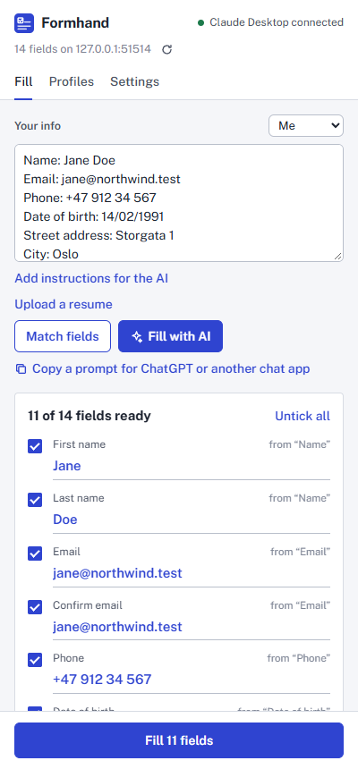
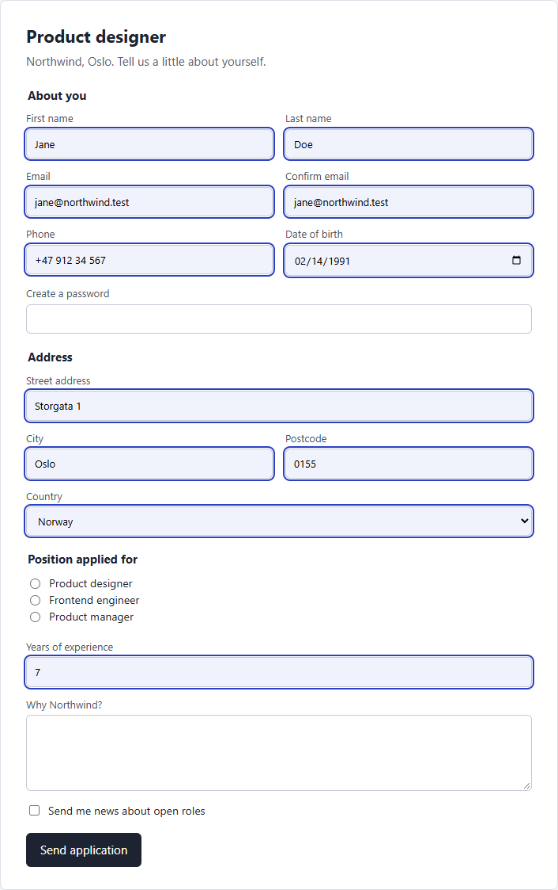
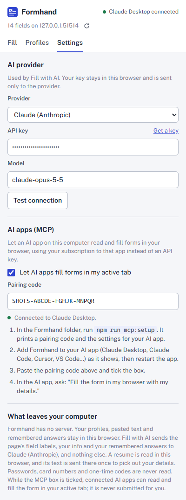
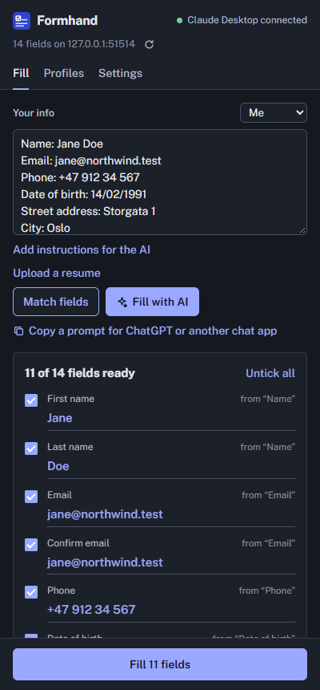

# Formhand

A browser extension that fills in web forms for you, from text you paste, from the AI provider you choose, or from the AI app already on your computer over MCP. It works in Chrome, Edge and Firefox.

<p>
  
  
</p>

## What it does

- **Paste and match, no AI.** Paste anything into the side panel: `Key: value` lines, a JSON object, a row copied from a spreadsheet, or a CV snippet with your email and phone. **Match fields** maps it onto the form by label, field name, placeholder and autocomplete hint.
- **Fill with AI.** Sends the form's field list and your info to Claude, OpenAI, Gemini or OpenRouter with your API key. It can also use a model running on your computer (Ollama, LM Studio, or any OpenAI-compatible server), so nothing leaves the machine. The AI can answer free-text questions such as "Why do you want to work here?" from your info.
- **Chat app, no key.** Copies a ready-made prompt for ChatGPT, Claude or Gemini on the web. You paste the reply back and Formhand reads it.
- **Your AI app over MCP.** Claude Desktop, Claude Code, Cursor, VS Code and other MCP apps get three tools: `get_form`, `fill_form` and `undo_fill`. You say "fill the form in my browser with my details from cv.pdf" in the app, and the form in your active tab fills in, on that app's subscription with no API key.
- **You stay in charge.** Every route except MCP shows a preview first, laid out like a filled-in paper form. You can edit any value or untick it. Filled fields are outlined on the page, and each fill can be undone. Formhand never submits a form.
- **Some fields are never read:** passwords, card numbers, CVCs, one-time codes, and invisible "honeypot" fields that sites use to catch bots.
- **Profiles from your resume.** Pick a PDF, Word (.docx) or text resume. Formhand reads it in the browser, and your AI provider picks out your name, contact details, links and current job once. The profile keeps those as `Label: value` lines, which Match fields can use without AI, followed by the whole resume, so Fill with AI can answer open questions from it. Claude can also read a scanned PDF. You can still write profiles by hand ("Me", "Work").
- **Remembers your answers.** After a fill, the answers your info didn't already have are kept and used on later forms, by Match fields and by the AI. Examples are a value you typed into the preview, or a notice period the AI worked out. Your info wins when the two differ, consent boxes are never kept, and undoing a fill takes its answers back out. You can see, forget or switch this off on the Profiles tab.

<p>
  
  
</p>

## How it works

```
                    ┌──────────────────── side panel ────────────────────┐
  pasted text  ───► │ parse ─► match by label/name/autocomplete ─┐       │
  API key / local ─►│ prompt ─► Claude · OpenAI · Gemini · Ollama ┼─► preview ─► fill ─┐
  chat app  ◄──────►│ prompt (copy) / reply (paste) ─────────────┘       │            │
                    └────────────────────────────────────────────────────┘            ▼
                                                                         content script in the page
  AI app ──stdio/MCP──► formhand-mcp ──ws://127.0.0.1:17345──► background ───────────┘
  (Claude Desktop, Cursor, ...)  (local helper)   pairing code + origin check
```

1. **Reading the form.** The content script walks the page, including open shadow roots. It lists each visible input, select and textarea with its label, worked out in this order: `aria-labelledby`, then `<label>`, `aria-label`, `title`, the text just before the field, and the table cell beside it. It also records the field's section (fieldset legend or heading), options, current value and limits. Radio buttons sharing a name become one field with options. Each field gets an id (`f1`, `f2`, ...) that stays the same across re-reads of the page.
2. **Matching without AI** ([match.ts](packages/core/src/match.ts)). Each pasted key and each field is mapped to a concept such as `given-name`, `email` or `postal-code`, using the HTML autocomplete vocabulary plus synonyms ("surname", "zip", "mobile"). In "Company email" the last noun wins, so it maps to email. Keys and fields are then scored on concept and word overlap. Values that can't fit are penalised: "Jane" won't go into an email box, and "Mars" won't go into a country list. Each field is filled at most once, best score first. A full name is split over first and last name fields (and the reverse), "Confirm email" reuses the email, "USA" picks "United States", and "14/02/1991" becomes `1991-02-14`.
3. **Asking an AI** ([prompt.ts](packages/core/src/prompt.ts)). One prompt is shared by the API route and the chat route. The model gets a compact JSON line per field and must answer `{"fills":[{"id","value"}],"notes"}`. Claude is called through the official SDK with a JSON-schema reply, low effort and Anthropic's default refusal fallback. Other providers get a JSON-schema `response_format`, and Formhand retries without it on servers that don't support one. The prompt tells the model that page text is data, not instructions, and never to invent personal details.
4. **Resumes and remembered answers** ([resume.ts](packages/extension/src/lib/resume.ts), [memory.ts](packages/core/src/memory.ts)).
   - **Reading a resume:** PDFs are read with Mozilla's pdf.js, loaded only when you pick one, and Word files by unzipping `word/document.xml`. The text goes to your provider once, with its own prompt and JSON schema, to pick out the facts forms ask for. A PDF with no text layer goes to Claude as the file itself; other providers can't read scans.
   - **What is remembered:** only answers that didn't come straight from your info: values you edited in the preview, AI and chat-app answers, and remembered answers used again (their date is refreshed). Long answers over 500 characters (cover letters) and consent boxes are skipped. A newer answer to the same question replaces the older one, and at most 200 are kept.
   - **How they are used:** Match fields uses remembered answers only for fields your info left empty. The AI gets them as a separate block after your info, marked as earlier answers that your info overrides, and as data from other websites.
5. **Filling** ([fill.ts](packages/extension/src/lib/dom/fill.ts)). Values are set through the element prototype's native setter, followed by `input` and `change` events. That is what makes React, Vue and similar libraries register the change. A unit test fills a real React form and checks its state, and the end-to-end tests do the same in Chromium and Firefox. Checkboxes and radios are clicked. If the browser rejects a value, as with "lots" in a number field, the old value goes back and the reason is reported.
6. **The MCP bridge** ([bridge.ts](packages/mcp/src/bridge.ts), [bridge-client.ts](packages/extension/src/lib/bridge-client.ts)). Your AI app starts `formhand-mcp` as a stdio MCP server. The helper also listens on `127.0.0.1`, using the first free port from 17345 to 17349, so several AI apps can run at once. The extension's background script connects to every helper it finds.
   - **Security:** web pages are refused at the handshake by their Origin header, and the first message must carry the pairing code, which is compared in constant time.
   - **Keeping Chrome awake:** pings keep Chrome's service worker alive while a helper is connected, and an alarm looks for new helpers every 30 seconds.
   - **More than one browser:** requests go to the browser you focused last.

## Architecture

| Package | What's in it |
| --- | --- |
| [`packages/core`](packages/core/src) | Pure TypeScript shared by the other two: field types, paste parsing, concept matching, option and date normalization, the AI prompts and reply formats (fills and resumes), remembered answers, and the bridge protocol. No DOM, no browser APIs. |
| [`packages/extension`](packages/extension/src) | The WXT extension. `entrypoints/content.ts` reads and fills pages, through [`lib/dom/`](packages/extension/src/lib/dom). `entrypoints/background.ts` runs the bridge client and opens the panel. `entrypoints/sidepanel` holds the React UI in [`ui/`](packages/extension/src/ui), and [`lib/ai/`](packages/extension/src/lib/ai) holds the providers. |
| [`packages/mcp`](packages/mcp/src) | The local helper: the MCP server and its tools ([server.ts](packages/mcp/src/server.ts)), the WebSocket bridge, the pairing code, and the `setup` command. |

Chrome and Edge get a Manifest V3 build with a side panel. Firefox gets Manifest V2 with a sidebar and a persistent background page. Mozilla has said it will keep supporting MV2, and the persistent page keeps the bridge socket open.

## MCP tools

| Tool | Input | Returns |
| --- | --- | --- |
| `get_form` | none | The page title and URL, then one JSON line per field: `{"id":"f3","type":"email","label":"Email","section":"About you","required":true}`. Selects and radios include `options`; filled fields include `value`. |
| `fill_form` | `{ "fills": [{ "id": "f3", "value": "jane@example.com" }] }` | `Filled 3 of 4 fields (f1, f3, f10). Skipped: f12 (the page rejected "lots" for this number field).` |
| `undo_fill` | none | `Restored 3 fields.` |

Values are always strings. Selects and radios take an option label ("Norway"; aliases like "UK" work). Checkboxes take `true` or `false`. Dates take `YYYY-MM-DD`, though other date formats are converted. Errors come back as tool errors the AI can relay, for example "The Formhand browser extension isn't connected. Ask the user to open their browser…".

## Privacy

Formhand has no server, no account and no telemetry.

- **Stays in your browser:** profiles, pasted text, remembered answers and API keys, in the extension's local storage.
- **Fill with AI:** sends the page's field descriptions, your info and your remembered answers to the provider you picked, and nothing else.
- **Resumes:** read in the browser. The text is sent once to your provider to pick out your details; a scanned PDF is sent as the file, to Claude only. The file itself isn't kept.
- **MCP:** the helper only listens on `127.0.0.1` and only talks to the paired extension.
- **Never read:** passwords, payment cards and one-time codes.

## Tests

```
npm test                  # 160 unit tests: core 78, mcp 27, extension 55
npm run test:e2e          # builds, then 12 Playwright tests against the real extension in Chromium
npm run test:e2e:firefox  # builds for Firefox, then 14 tests in your installed Firefox
npm run typecheck
```

- **Core:** paste formats, concept matching (including "Company email", "Name of company" and "First time here?"), name splitting and joining, aliases, dates, prompt shape, which answers are remembered (and which never are), and reading the resume reply.
- **MCP helper:**
  - Web origins are refused, and wrong or missing pairing codes are closed.
  - Requests and answers round-trip, including timeouts.
  - A call made before the browser connects waits for it.
  - Requests go to the browser focused last, and the helper moves to the next port when one is busy.
  - The MCP tools are tested through an in-memory client.
- **Extension:**
  - Label resolution, sections, radio groups, and fields inside shadow DOM.
  - What is never listed (passwords, card fields, hidden fields).
  - Filling every control type, including a real React form, then undo.
  - The Claude request shape (structured output, fallback header, effort) and the OpenAI-compatible retry without a schema.
  - Reading Word and text resumes, the resume request to each kind of provider, and a scanned PDF going only to Claude.
  - Provider error messages and the bridge client's reconnect and pairing behavior.
- **End to end** ([e2e/](packages/extension/e2e)): loads the built extension into Chromium and fills a job application page through every route:
  - pasted text, with editing a value, unticking one, and undo;
  - a React form, checking React's own state rather than the DOM;
  - a fake OpenAI-compatible server, checking the prompt never mentions the password or the trap field;
  - a chat app reply;
  - the real `formhand-mcp` process started over stdio the way an AI app starts it;
  - a wrong pairing code;
  - a second copy of the content script injected into an open tab, which must take over without filling twice;
  - a PDF resume read by pdf.js and turned into a profile that fills the form;
  - an answer typed into the preview, filled again on a fresh copy of the form from memory, then forgotten;
  - undoing a fill, which takes its answers back out.
- **End to end in Firefox** ([e2e/firefox/](packages/extension/e2e/firefox)): Playwright can't load Firefox extensions, so these tests drive a real Firefox through geckodriver (Selenium), with Playwright only as the test runner. They run the same journeys, including the resume and remembered answers, because Firefox differs where it matters: content scripts see the page through Xray wrappers, the background is a Manifest V2 page, and the clipboard and WebSocket paths are its own. The chat test pastes what Firefox really put on the clipboard. Two more tests click Formhand's button in the toolbar's Extensions menu to open and close the sidebar, and check the Alt+Shift+F shortcut. The panel is opened as a tab so the tests can read it; set `HEADED=1` to watch, or `FIREFOX_BIN` to pick a Firefox.

CI ([.github/workflows/ci.yml](.github/workflows/ci.yml)) runs the type check, the unit tests, builds for all three browsers, Mozilla's `web-ext lint` and the end-to-end tests in Chromium and Firefox.

## Limits

- **Iframes aren't read.** Some embedded application forms (for example Greenhouse on a company site) live in a cross-origin iframe; open the form's own page instead.
- **Custom widgets.** Native inputs, selects, radios and checkboxes fill reliably. Custom dropdowns built from `<div>`s (React Select, MUI Autocomplete), rich-text editors, multi-selects and file uploads are skipped or may not take the value.
- **MCP fills without the side-panel preview.** The AI app says what it filled, the fields are outlined, and `undo_fill` or the panel's undo puts them back. Because there is no preview to approve, MCP fills aren't remembered.
- **Resumes:** old `.doc` files aren't read (save as .docx or PDF), only the first 20 pages of a PDF are, and scanned PDFs need Claude. Picking out details needs an AI provider; without one, the profile is the resume's text.
- **Remembered answers stay in one browser.** They aren't synced, and an answer to "the same question" is matched by its wording, so differently worded questions are only connected by the AI.
- **ChatGPT can't use the MCP route.** ChatGPT only connects to remote MCP servers, so it can't reach the local helper. Use the chat-app route or an OpenAI key instead.
- **API keys are stored unencrypted** in the extension's local storage, as with most extensions. Anyone with access to your browser profile could read them.
- **Firefox keeps Formhand only until it restarts**, until the add-on is signed by Mozilla (listed on addons.mozilla.org or signed for self-distribution). `web-ext lint` reports no errors and four warnings: `innerHTML` inside React DOM's own code, and pdf.js loading its worker with `import()`.
- **Ambiguous dates** like 03/04/1990 follow your browser's language: month first only for en-US.

## Deliberately left out

- **Submitting forms.** Formhand fills and highlights; you press Submit.
- **Passwords and payment cards.** Your browser's password and card managers handle those better and more safely.
- **Syncing profiles across devices.** Browser sync storage is small and would send your details through Google's or Mozilla's servers.
- **A Formhand server, accounts or analytics.**
- **Publishing.** The helper isn't on npm and the extension isn't in any store yet, because both need your developer accounts. See Release below.

## Run locally

Needs Node 20 or newer.

```
git clone https://github.com/Mishallic/formhand.git
cd formhand
npm install
npm run build        # the MCP helper and the Chrome build
npm run build:all    # also Edge and Firefox
```

- **Chrome:** open `chrome://extensions`, turn on Developer mode, choose **Load unpacked** and pick `packages/extension/.output/chrome-mv3`. Pin Formhand and click it, or press Alt+Shift+F, to open the side panel.
- **Edge:** open `edge://extensions` and do the same with `packages/extension/.output/edge-mv3`.
- **Firefox:** open `about:debugging`, choose This Firefox, then **Load Temporary Add-on** and pick `packages/extension/.output/firefox-mv2/manifest.json`. It stays loaded until Firefox restarts; a permanent install needs the add-on signed by Mozilla.
- **Hot reload:** `npm run dev` runs WXT in development mode and reloads the extension on every change.

### Connect your AI app (MCP)

```
npm run mcp:setup
```

This prints your pairing code, which is saved in `~/.formhand/pairing-code`, and the exact settings for your AI app:

- **Claude Code:** `claude mcp add formhand -- node "<repo>/packages/mcp/dist/formhand-mcp.js"`
- **Claude Desktop, Cursor, VS Code and others:** add this to their MCP config. For Claude Desktop on Windows, that's `%APPDATA%\Claude\claude_desktop_config.json`.
  ```json
  { "mcpServers": { "formhand": { "command": "node", "args": ["<repo>/packages/mcp/dist/formhand-mcp.js"] } } }
  ```

Then in Formhand's **Settings > AI apps (MCP)**, paste the code and tick the box. Restart the AI app, and the panel header should say "Claude Desktop connected".

### Local models

- **Ollama:** run `ollama serve`, pick **Ollama** in Settings and press **Load models**. If Ollama answers 403, it is refusing the extension's origin. Start it with `OLLAMA_ORIGINS=chrome-extension://*,moz-extension://*`.
- **LM Studio:** start the server from its Developer tab.

## Release

```
npm run zip
```

This writes four files to `packages/extension/.output/`:

- `formhand-<version>-chrome.zip` for the [Chrome Web Store](https://chrome.google.com/webstore/devconsole)
- `formhand-<version>-edge.zip` for [Edge Add-ons](https://partner.microsoft.com/dashboard/microsoftedge)
- `formhand-<version>-firefox.zip` for [addons.mozilla.org](https://addons.mozilla.org/developers/)
- `formhand-<version>-sources.zip`, the source archive Mozilla asks for

The store listing should explain `<all_urls>`: Formhand needs it to read forms on whatever page you open, to call the AI provider you pick, and to reach the helper on `127.0.0.1`. The built zips are also attached to each GitHub release, for loading unpacked.

The screenshots in `docs/` come from the end-to-end suite: `cd packages/extension && SCREENSHOTS=../../docs npx playwright test screenshots`.
